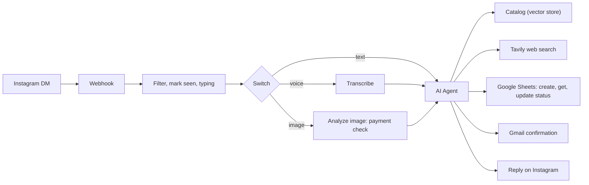

# Instagram AI Sales Agent (n8n)

An AI sales assistant for Instagram DMs, built with n8n. It answers customers in English or Roman Urdu, understands voice notes, pre-screens payment screenshots, saves orders to Google Sheets and emails confirmations.

> **Demo project.** The example brand "Saey Fragrances" is used for demonstration only. This repo is unofficial and not affiliated with or endorsed by the brand. Replace the brand name, catalog, contact details and payment number with your own.

## What it does

- Replies in the customer's language (English or Roman Urdu)
- Transcribes voice notes (OpenAI) and handles them like text
- Reads payment screenshots (OpenAI vision) and checks receiver, app, amount and date. Unclear payments are marked PENDING for a human to verify
- Recommends products from your catalog (vector store) and researches perfumes on the web (Tavily)
- Creates orders in Google Sheets and updates their status (paid, pending, cancelled). It never deletes rows
- Emails the customer a confirmation with the order number (Gmail)

## How it works

## Tools

n8n (self-hosted), OpenAI, Google Sheets, Google Drive, Gmail, Tavily, Meta Instagram API.

## Setup

1. Import `instagram-ai-sales-agent.json` into n8n (Workflows, then Import from file).
2. Create credentials for: OpenAI, Google Drive (OAuth2), Google Sheets (OAuth2), Gmail (OAuth2) and Tavily MCP. Assign them to the nodes that show a credential warning.
3. Create a Google Sheet with these columns in row 1: `Order Number`, `Customer Name`, `Phone Number`, `E-mail`, `Address`, `Order Details`, `Order Status`. Format the Phone Number column as plain text so the leading zero is kept.
4. Write your product catalog as a Google Doc with product names, notes, sizes and prices in rupees.
5. Replace the placeholders listed below.
6. Run the manual trigger once to load the catalog into the vector store.
7. Create a Meta app with the Instagram API, connect an Instagram professional account, and point the webhook to `https://YOUR-DOMAIN/webhook/instagram-webhook`. Subscribe to messages.
8. Publish the workflow.

## Placeholders to replace

| Placeholder | Where | What to put |
|---|---|---|
| `YOUR_INSTAGRAM_ACCESS_TOKEN` | HTTP Request, HTTP Request1, HTTP Request2 | Your Instagram access token. Never commit a real token |
| `YOUR_GOOGLE_SHEET_ID` | Create Order, Get Order, Update Order Status | The ID of your orders sheet |
| `YOUR_GOOGLE_DRIVE_FILE_ID` | Download file | The ID of your catalog document |
| `03XXXXXXXXX` and `XXXX` | AI Agent system message | Your JazzCash or Easypaisa number and its last 4 digits |
| `support@yourbrand.example`, `+92 3XX XXXXXXX`, `@your_brand`, `yourbrand.example` | AI Agent system message | Your own support contacts and website |

## Known limitations

- Instagram messaging only works for accounts with a role on your Meta app until the app passes Meta's App Review.
- The vector store is in memory, so the catalog is lost whenever n8n restarts. Use a persistent store for production.
- There is no error alerting or retry logic yet.
- The payment check is visual only. The owner must confirm the money in the account.
- The webhook does not verify Meta's verify token or the `X-Hub-Signature-256` header.
- Instagram limits a DM to 1,000 characters, so the agent prompt keeps replies under 600.
- The Update Order Status tool changes only the status. Requests to change name, phone, email, address or products are handed to a human.
- During testing, one message sometimes triggered repeated runs, probably webhook retries. An `Acknowledge Webhook` node now replies to Meta immediately. Please verify this in your own setup.

## License

MIT
